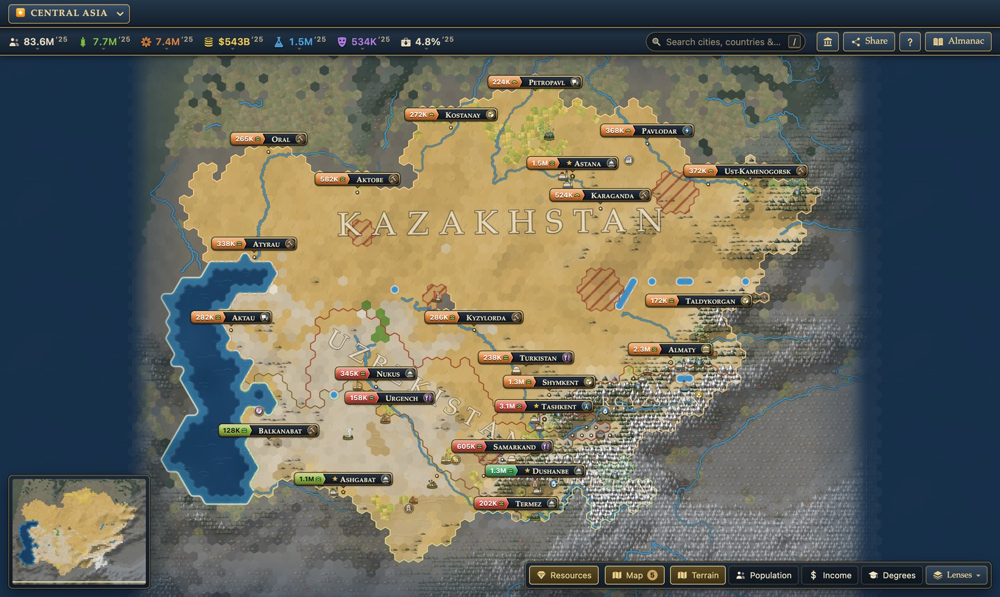
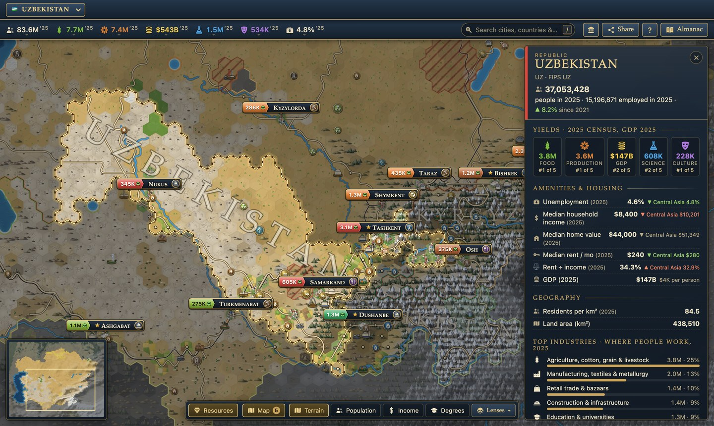
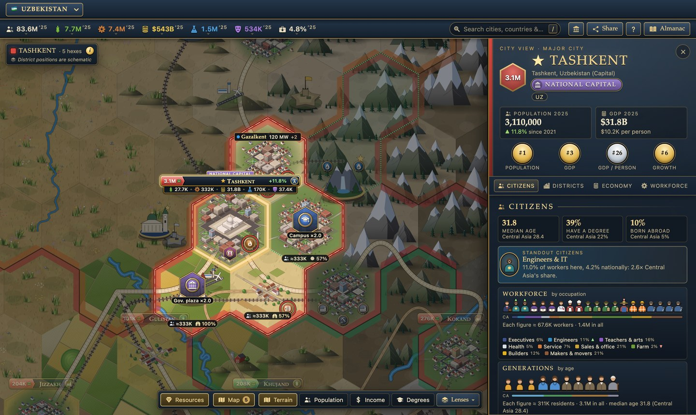
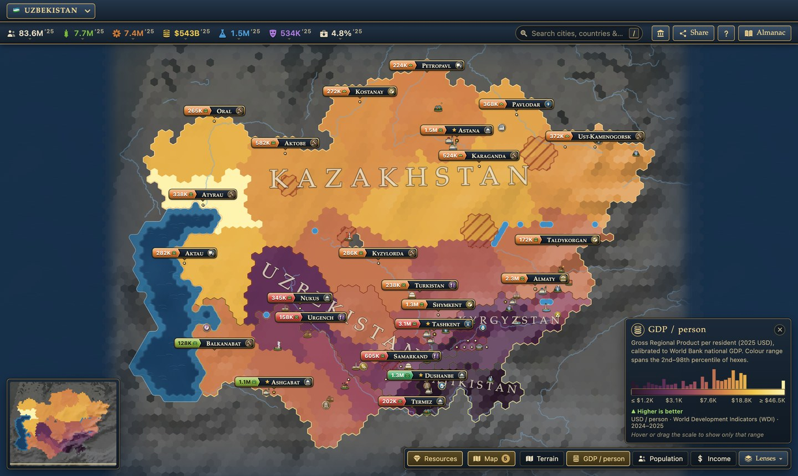
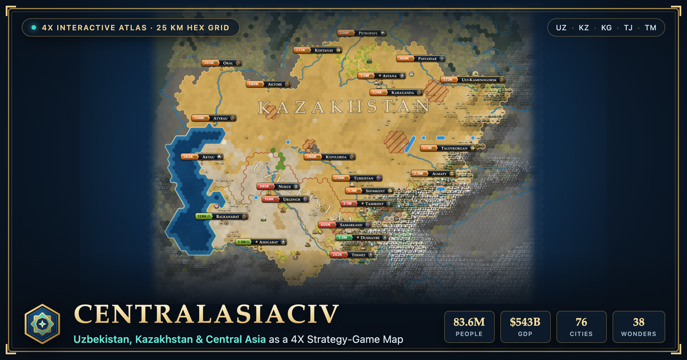

# CentralAsiaCiv — Central Asia as a 4X Strategy-Game Map

**Live Demo:** [centralasiaciv.vercel.app](https://centralasiaciv.vercel.app/)



**CentralAsiaCiv** draws the five republics of Central Asia — **Uzbekistan, Kazakhstan, Kyrgyzstan, Tajikistan, and Turkmenistan** — like a turn-based 4X strategy game map, built entirely from real public geospatial and statistical data.

Inspired by Andrej Karpathy's original [usaciv](https://karpathy.ai/usaciv) ([announcement](https://x.com/karpathy/status/2125779541952246039)) and built on the MIT-licensed [EarthCiv](https://github.com/earthciv/earthciv) Canvas 2D hex engine, CentralAsiaCiv projects **4.0 million km²** of Eurasia — from the Caspian Sea basin (-28 m) across the Karakum and Kyzylkum deserts and the Great Kazakh Steppe up to the 7,495 m snow-capped Pamir and Tian Shan mountains — onto a unified **25 km hexagonal grid** (`80 × 73` hexes).

<table>
  <tr>
    <td></td>
    <td></td>
  </tr>
  <tr>
    <td></td>
    <td></td>
  </tr>
</table>

---

## Regional Snapshot (2025)

| Republic | Capital | Population (2025) | GDP (2025 USD) | GDP / Capita | Major Cities Mapped |
|---|---|---:|---:|---:|---:|
| **Uzbekistan (UZ)** | Tashkent | 37.05M | $147.0B | $3,968 | 22 (Tashkent, Namangan, Samarkand, Andijan, Nukus, Fergana, Bukhara, Karshi, Kokand, Navoiy, Urgench, Khiva, Termez…) |
| **Kazakhstan (KZ)** | Astana | 20.84M | $306.2B | $14,692 | 25 (Almaty, Astana, Shymkent, Aktobe, Karaganda, Taraz, Ust-Kamenogorsk, Pavlodar, Atyrau, Semey, Kyzylorda, Aktau, Turkistan, Baikonur…) |
| **Tajikistan (TJ)** | Dushanbe | 10.79M | $17.7B | $1,637 | 10 (Dushanbe, Khujand, Bokhtar, Kulob, Istaravshan, Tursunzoda, Panjakent, Nurek, Khorog…) |
| **Turkmenistan (TM)** | Ashgabat | 7.62M | $49.8B | $6,540 | 9 (Ashgabat, Turkmenabat, Dashoguz, Mary, Balkanabat, Turkmenbashi, Bayramaly, Tejen, Kerki) |
| **Kyrgyzstan (KG)** | Bishkek | 7.34M | $22.6B | $3,081 | 10 (Bishkek, Osh, Jalal-Abad, Karakol, Tokmok, Uzgen, Balykchy, Naryn, Talas, Batken) |
| **Central Asia Total** | **5 Capitals** | **83.65M** | **$543.4B** | **$6,496** | **76 Cities · 48 Provinces** |

*National totals are calibrated directly to World Bank World Development Indicators (2025).*

---

## What's Inside

- **Painted 25 km Hex Terrain:** Real NOAA ETOPO1 relief raises the Pamir, Tian Shan, and Altai ranges and carves the Caspian Sea's 1,025 m southern abyss, while NASA MODIS satellite land cover paints the Kazakh Steppe, Kyzylkum & Karakum deserts, northern wheat belt, Altai & Tian Shan spruce forests, and irrigated oases of the Fergana Valley, Zarafshan, and Amu Darya deltas.
- **5 National Yields:**
  - **Food** — Agricultural, irrigated cotton, wheat & livestock workers (`7.7M`)
  - **Production** — Manufacturing, metallurgy, construction, mining & oil/gas workers (`7.4M`)
  - **Gold** — GDP in current U.S. dollars (`$543B`)
  - **Science** — IT parks, telecom, scientific & engineering workers (`1.5M`)
  - **Culture** — Arts, Silk Road heritage & cultural workers (`534K`)
- **16 Interactive Data Lenses (48 Provinces):** Population density, 2021–2025 population growth, median age, household income, GDP per person, poverty, homeownership, higher education degrees, internet access, average commute, religious adherence, largest faith tradition (Hanafi Sunni Islam, Ismaili Shia in the GBAO Pamirs, Orthodox pluralities in Northern Kazakhstan), natural hazard exposure, forest cover, farmland & oases, and built-up area — each with a brushable histogram legend.
- **76 Cities & Full City View:** Click any city banner (e.g., **Tashkent**, **Almaty**, **Astana**, **Samarkand**, **Bishkek**, **Dushanbe**, **Ashgabat**, **Atyrau**, **Baikonur**) to open its **City View** featuring citizen icon rows (occupation, age, commute, education, origin), location-quotient specialization districts (*Campus*, *Commercial Hub*, *Industrial Zone*, *Caspian Port*, *Silk Road Quarter*, *Government Plaza*, *Hydro & Power*), city-type badges, GDP by industry, resource sites, and peer cities.
- **117 Energy & Mineral Resource Sites:** 74 WRI power stations ≥ 25 MW plus major commissioned projects (**Rogun HPP**, **Syrdarya 1,500 MW CCGT**, **Zarafshan 500 MW Wind**, **Nur Navoi & Samarkand Solar**) alongside flagship mines (**Muruntau** — world's largest open-pit gold mine, **Almalyk** copper, **Kumtor** gold, **Chu-Sarysu & Uchkuduk** uranium belt supplying >50% of world uranium, **Bogatyr** coal, **Sokolov-Sarbay** iron, **Donskoy** chromite) and supergiant hydrocarbon basins (**Tengiz**, **Kashagan**, **Karachaganak**, **Galkynysh**, **Shurtan**, **Gazli**).
- **38 Wonders (4 Published Rules):**
  - *12 National Parks & Biosphere Reserves:* Burabay, Ile-Alatau, Ugam-Chatkal, Issyk-Kul, Kolsai Lakes, Ala-Archa, Zaamin, Charyn Canyon, Altyn-Emel, Katon-Karagay, Sary-Chelek, and Tajik National Park (Pamirs).
  - *4 Geological & Ecological Monuments:* Darvaza Gas Crater, Song-Köl, Tigrovaya Balka, Repetek.
  - *10 Research Universities:* Nazarbayev University, Al-Farabi KazNU, National University of Uzbekistan, Satbayev University, Gumilyov ENU, Tashkent State Technical University, Samarkand State University, AUCA/KNU, Tajik National University, Magtymguly TSU.
  - *12 Silk Road UNESCO & Modern Landmarks:* Registan Square (Samarkand), Historic Centre of Bukhara, Itchan Kala (Khiva), Mausoleum of Khoja Ahmed Yasawi (Turkistan), **Baikonur Cosmodrome**, Ancient Merv, Kunya-Urgench, Sulaiman-Too (Osh), Petroglyphs of Tamgaly, Burana Tower, Sarazm, and Shakhrisabz.
- **Infrastructure, Trade Corridors & Military:** 946 rasterized highway links and 520 rail links (Trans-Caspian, Turksib, Afrosiyob HSR, China–Europe rail), 7 Caspian seaports & Silk Road dry ports (**Aktau**, **Kuryk**, **Turkmenbashi**, **Khorgos Gateway**, **Dostyk**, **Termez**, **Bautino**), 32 commercial airports, 20 major freight & pipeline trade corridors (Middle Corridor / TITR, Central Asia–China Gas Pipeline), 26 military bases and 5 restricted space/test ranges (Baikonur, Sary Shagan, Semipalatinsk, Emba, Kattakurgan), plus 20 major recorded Central Asian natural disasters (1980–2025).
- **10 Interactive Advisors + Country Switcher:** Docked dashboards for *Energy & Resources*, *Economy*, *People*, *Prosperity & Housing*, *Knowledge*, *Land*, *Military*, *Commerce*, *Culture*, and the *Explorer* (scatter plots & filterable tables for countries, cities, and all 48 provinces), plus a top-left country selector to fly directly to Uzbekistan, Kazakhstan, Kyrgyzstan, Tajikistan, or Turkmenistan.
- **Custom Silk Road Design Assets:** Custom-designed Timurid *Rub el Hizb* lapis-and-gold hexagonal favicon (`favicon.svg`, `favicon.png`, `apple-touch-icon.png`) and custom 1200×630 Open Graph social card (`og-image.png`).

---

## Controls & Shortcuts

| Action | Control |
|---|---|
| Pan map | Drag or `WASD` / Arrow keys |
| Zoom | Mouse wheel, pinch, `+` / `−`, or double-click |
| Inspect country / city | Click any hex (republic profile) or city banner (City View) |
| Jump to republic | Use top-left **Central Asia** selector |
| Search cities, countries & provinces | `/` or `⌘K` / `Ctrl+K` |
| Cycle data lenses | `L` |
| Toggle resource markers | `R` |
| Keyboard shortcuts & Almanac | `?` or top-right **Almanac** button |

---

## Data Sources

All data comes from public, open datasets (no API keys required), logged with URLs and SHA-256 checksums inside the in-app **Almanac → Sources**:

| Source | Publisher | Used for |
|---|---|---|
| **Natural Earth v5.1.2 (1:10m)** | Natural Earth (Public Domain) | Country borders, 48 admin-1 provinces, Caspian Sea & lakes (Aral, Balkhash, Issyk-Kul), rivers, highways, railroads |
| **ETOPO1 Global Relief Model** | NOAA NCEI (Public Domain) | 5 arc-minute elevation, Pamir/Tian Shan/Altai alpine relief, Caspian Sea bathymetry |
| **MODIS Combined L3 IGBP Land Cover (2022)** | NASA GIBS / EOSDIS (Public Domain) | Satellite terrain cover (steppe, desert, irrigated oases, forest, alpine snow, urban) & land lenses |
| **World Development Indicators (2019–2025)** | World Bank (CC BY 4.0) | Population, 2021–25 growth, GDP, GDP per capita, unemployment, internet, urbanization, defense totals |
| **Global Power Plant Database v1.3.0** | World Resources Institute (CC BY 4.0) | 74 Central Asian hydro, gas, coal, solar & oil power stations ≥ 25 MW (+ major 2020–25 additions) |
| **OurAirports Open Dataset** | OurAirports (Public Domain) | Exact IATA/ICAO positions of 32 Central Asian commercial airports |
| **National Statistical Yearbooks & ADB CAREC** | Stat.uz, Stat.gov.kz, Stat.kg, Stat.tj, ADB, USGS, UNESCO, EM-DAT, SIPRI | Sub-national province & city profiles, flagship mines & oil/gas basins, UNESCO wonders, corridors & disasters |

---

## Local Development & Rebuilding the Data

The site in `web/` is a zero-build static ES-module + Canvas 2D app (~1.3 MB of compressed JSON data in `web/data/ca5/`).

### Run locally

```bash
python3 -m http.server 8765 --directory web
# Open http://127.0.0.1:8765
```

### Rebuild all datasets from public sources

Requires [uv](https://docs.astral.sh/uv/) (Python 3.11+):

```bash
# 1. Download and cache raw public geospatial & World Bank datasets (~200 MB) into data/raw/central_asia/
uv run --group build python -m pipeline.fetch_ca

# 2. Project onto the 25 km Albers Equal-Area hex grid and generate all 17 JSON files in web/data/ca5/
uv run --group build python -m pipeline.build_central_asia

# 3. Run headless Chromium verification and regenerate favicon PNGs, OG image & README screenshots
uv run --group harness python -m pipeline.render_assets
```

---

## Project Structure

```text
centralasiaciv/
├── pipeline/
│   ├── fetch_ca.py             # Cached downloads from Natural Earth, NOAA ETOPO1, NASA MODIS, WRI, OurAirports & World Bank
│   ├── ca_data.py              # Central Asia republics, 48 provinces, 76 cities, mines/fields, 38 wonders, corridors & disasters
│   ├── build_central_asia.py   # Albers Equal-Area projection, 25 km hex sampler & 17-file EarthCiv v3 contract builder
│   ├── geo_helpers.py          # Relief classification, valley smoothing, polyline clipping & hex ring utilities
│   ├── render_assets.py        # Headless Chromium smoke verifier + favicon PNG, OG image & screenshot renderer
│   └── core/                   # Cached fetcher with SHA-256 provenance, hexgrid & atomic store
├── web/
│   ├── index.html              # Standalone CentralAsiaCiv entrypoint with custom SVG/PNG favicons & OG metadata
│   ├── favicon.svg             # Custom Timurid Rub el Hizb lapis & gold hex emblem
│   ├── favicon.png             # 64×64 PNG favicon
│   ├── apple-touch-icon.png    # 180×180 Apple touch icon
│   ├── og-image.png            # Custom-designed 1200×630 Open Graph social card
│   ├── css/                    # 4X strategy UI stylesheets
│   ├── js/                     # Plain ES-module Canvas 2D hex renderer, City View, 10 Advisors & map layers
│   └── data/
│       ├── editions.json       # Edition index (ca5)
│       └── ca5/                # 17 built JSON datasets (world, cities, states, nation, lenses, counties, resources, …)
├── docs/images/                # Live rendered map screenshots
├── vercel.json                 # Static deployment & cache configuration for Vercel
├── pyproject.toml              # uv dependency groups (build, harness)
└── LICENSE                     # MIT License
```

---

## Credits & License

- **Engine & Inspiration:** Built on Andrej Karpathy's [usaciv](https://karpathy.ai/usaciv) and the MIT-licensed [EarthCiv](https://github.com/earthciv/earthciv) multi-edition map engine.
- **License:** Code is MIT-licensed (see [LICENSE](LICENSE)). Underlying public datasets retain their respective open licenses (Public Domain / CC BY 4.0) as detailed in the in-app **Almanac**.
